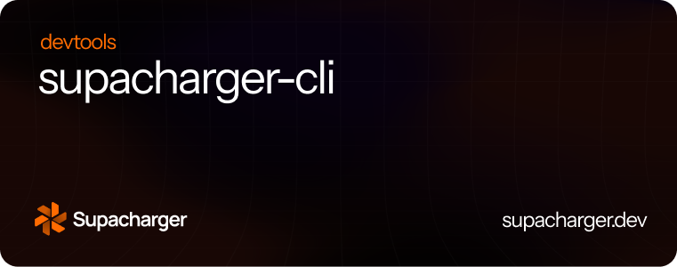

# Supacharger CLI



[](https://www.npmjs.com/package/@glowplug/supacharger-cli)

**npm package:** [`@glowplug/supacharger-cli`](https://www.npmjs.com/package/@glowplug/supacharger-cli) · **Terminal command:** `supacharger`

Supacharger CLI is a command-line tool for installing and maintaining Core, the shared foundation of your web app. Create a project, check for changes, update Core, and add agent skills or extensions from your terminal.

Use it alongside your coding agent and MCP (Model Context Protocol) tools to set up, deploy and manage Supacharger. Your agent guides the work, the CLI manages project files, and MCP connects the agent to project guidance and service tools. Your agent uses the relevant hosting and service tools for deployment.

Explore [supacharger.dev](https://supacharger.dev) or visit the [main Supacharger project](https://github.com/glowplug-studio/supacharger).

## Install from npm

With Node.js and npm installed, run:

```bash
npm install -g @glowplug/supacharger-cli@latest
supacharger --version
```

The `-g` option makes the command available across your projects. The same install command updates the CLI later. Use `supacharger --help` to see the commands in your installed release.

## Guides

| What you want to do | Read |
| --- | --- |
| Create a project and work with an agent and MCP | [Getting started](https://github.com/glowplug-studio/supacharger-cli/blob/main/docs/getting-started.md) |
| Check and update an existing app | [Updating Core](https://github.com/glowplug-studio/supacharger-cli/blob/main/docs/updating-core.md) |
| Review configuration changes in an older app | [Upgrade notes](https://github.com/glowplug-studio/supacharger-cli/blob/main/docs/upgrade-notes.md) |
| Give your agent reusable instructions | [Agent skills](https://github.com/glowplug-studio/supacharger-cli/blob/main/docs/agent-skills.md) |
| Add optional application features | [Extensions](https://github.com/glowplug-studio/supacharger-cli/blob/main/docs/extensions.md) |
| Look up a command or option | [Command reference](https://github.com/glowplug-studio/supacharger-cli/blob/main/docs/command-reference.md) |
| Work on the CLI or Core itself | [Contributor guide](https://github.com/glowplug-studio/supacharger-cli/blob/main/docs/contributing.md) |

The guides follow this repository's source. Some features may be ahead of the published npm package; see the [changelog](https://github.com/glowplug-studio/supacharger-cli/blob/main/CHANGELOG.md).

## Delete a user through the application policy

```bash
supacharger nuke -u <user-uuid> --url https://your-application.example
```

Set the matching server-only `ACCOUNT_DELETION_ADMIN_SECRET` in the environment or the local `.env.local` file. The command never accepts the secret as an argument. Set `SUPACHARGER_APP_URL` there to omit `--url`. The application must provide the administrator deletion endpoint, an approved enabled deletion policy and a ready worker. HTTPS is required except for local loopback development; redirects are refused.

The command displays the application, Supabase project, target UUID, deletion scope and retention rules. It requires the UUID to be typed again before submission. For deliberate non-interactive use, add `--confirm <same-user-uuid>`. Policy blockers stop submission. An accepted job runs asynchronously through the same cleanup handlers as account deletion; queue acceptance does not mean cleanup has completed. Keep the printed job reference, especially if the response is lost, and inspect that job before retrying.

Supacharger supplies no administrator panel. This command is a privileged alternative; it does not bypass the policy or delete the Auth user directly.
